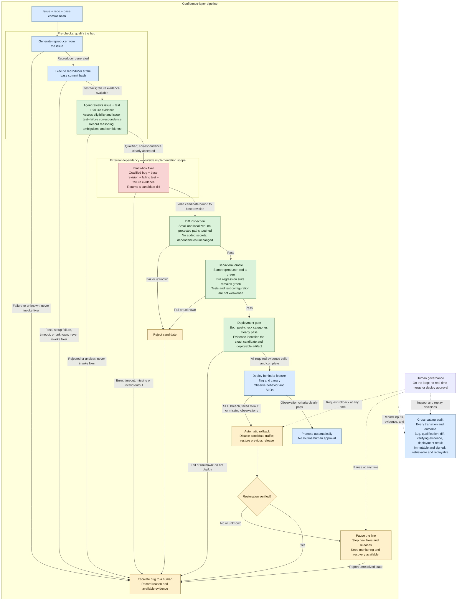

# Confidence layer: flow for review

Status: agreed planning checkpoint from the grilling discussion, 2026-10-18. This captures the agreed pipeline and constraints; unresolved implementation choices are listed explicitly below. This checkpoint does not authorize implementation.

Source: [SAP challenge brief](<SAP - AI Hackathon with Nebius & NVIDIA.pdf>), especially pages 1–2, and the team's diagram discussed in this chat.

## Agreed scope and constraints

- **Delivery constraint:** approximately one hour remains for the whole project at this checkpoint. Prefer the smallest practical implementation of the brief.
- **Target repository:** the existing `kAWEOME/nebius-nvidia-code` repository can be repurposed as needed. Express and its existing issue are available fixtures, not product requirements. The product requires at least one GitHub issue associated with the target repository to process.
- **Trivial bugs:** use the brief's definition: an automatically generated test reproduces the bug, and the resulting fix is a small, localized diff. Everything else escalates. No additional semantic bug-class allowlist is agreed. Enforce a strict, minimal interpretation of small/localized; exact limits remain open.
- **Interface:** CLI and GitHub only; no dashboard. Represent issue progress through GitHub issue labels. Exact labels and triggers remain open.
- **Repository prerequisites:** expect minimal setup, primarily the existing test coverage. A mandatory repository configuration format or automatic infrastructure discovery is not agreed.
- **Qualification:** use a fresh agent with a skill-based heuristic. A fresh review context avoids inheriting the generator's conversational reasoning; it does not establish absence of bias or calibrated accuracy. The exact rubric and treatment of inferred expectations remain open.
- **Fixer attempts:** one external fixer attempt per run. Errors, timeouts, invalid candidates, or failed gates escalate. An intentional rerun is a new recorded attempt, not an automatic repair loop.
- **Audit:** preserve the trace of the entire pipeline, including inputs, execution results, skill version, judge assessments, candidate patch, and deployment observations. Choose pragmatic persistence; the storage mechanism and replay semantics remain open. Signed, immutable, retrievable evidence remains a brief requirement.

## How to read this flow

- **Fail closed:** a failed, missing, inconclusive, or timed-out check never counts as a pass. Before deployment, reject or escalate without shipping. After possible traffic exposure, recover the previous release and verify the result.
- **Qualification is provisional:** pre-checks establish an eligible bug and a genuine reproducible failure. The actual patch's size and locality can only be enforced after the fixer returns it. An unrelated test failure or broken environment does not qualify a bug.
- **Both post-check categories are mandatory:** diff inspection and behavioral verification cannot compensate for each other. Their sequential arrangement here is illustrative, not a scheduling requirement.
- **Evidence stays bound to its subject:** distinguish the base commit, candidate diff/revision, reproducer, test execution, and deployed artifact. The deployed artifact must be the one verification authorized. The fixer cannot weaken the tests, test command, or gate policy to manufacture success.
- **The fixer stays external:** neither its internals nor its runtime hosting/containment belongs to this implementation. Executing verification tests is part of the confidence layer.
- **Audit covers failures too:** the audit connection represents every transition, including refusal, rejection, escalation, promotion, rollback, and human intervention. Signatures establish authenticity and integrity; immutable retention is a separate property to implement and verify.
- **Audit failure cannot authorize release:** missing required audit evidence prevents deployment or promotion. If evidence cannot be recorded during exposure, roll back; recovery must remain possible even when the audit writer is unavailable. Report any recording gap explicitly.
- **Human intervention is an override:** pause stops new fixer and release actions; it does not stop monitoring or recovery. A human-requested rollback still requires verification. Routine successful runs need no human approval.
- **Escalation is an outcome, not an automatic approval request:** the unattended run stops. Human investigation or a later attempt is outside the successful path shown here.

## Reproducer qualification

The agreed qualification input is **Issue + repo + base commit hash**. The confidence layer generates a reproducer from the issue and executes it against that exact repository revision before invoking the fixer.

A fresh agent following a qualification skill evaluates the issue, generated test, and execution evidence together. It assesses whether the test exercises the reported action, what evidence supports its expected behavior, and whether the observed failure reproduces the reported symptom. It records its reasoning, ambiguities, confidence, and qualification decision. A passing test, setup failure, or unclear correspondence does not qualify the bug; missing evidence and timeouts also lead to escalation without invoking the fixer.

This agent-based assessment is an agreed design choice, not a mechanism prescribed by the challenge brief. No separately approved behavioral specification is required. The agent must distinguish expectations stated in the issue from its own inferences and identify missing or contradictory expectations. Its confidence is an assessment, not a calibrated probability of correctness. Qualification remains subject to bug eligibility and does not replace the later diff, regression, or deployment checks.

Required qualification audit evidence:

- Issue snapshot, repository identity, and base commit hash.
- Generated test, execution command, and execution result, including available failure evidence.
- Judge assessment: action match, expected-behavior support, failure match, reasoning, ambiguities, confidence, and qualification decision.

The qualified bug, failing test, and failure evidence passed to the fixer remain bound to the same base commit hash. The confidence representation and acceptance rule remain open; no numerical threshold is agreed.

## External fixer handoff

Send the issue, exact base revision, qualified reproducer, and failure evidence to the external fixer. Accept one candidate patch bound to that revision and verify it in a clean checkout. The fixer cannot modify the preserved reproducer or other verification controls to make its candidate pass.

The representation of the qualified reproducer is still open: the discussion has not yet selected a test-file bundle, patch, or other transport format. The external provider and timeout also remain open.

## Required demonstration coverage

The brief calls for a handful of seeded trivial bugs completing the full path unattended through deployment and audit, followed by a genuinely difficult bug being refused and escalated. One available GitHub issue is the product's input prerequisite; it does not replace this multi-bug demonstration requirement. No exact bug count beyond the brief is agreed.

Exercises for a rejected candidate, missing evidence, canary rollback, and audit verification are additional review recommendations, not added demo acceptance requirements.

## Decisions still open

- Concrete demo application and seeded bugs; repository identity and existing Express behavior do not constrain this choice.
- Confidence representation and acceptance rule for the agreed agent-based issue–test–failure assessment, including when inferred expectations are sufficient to qualify a bug.
- Executable definitions of small/localized, protected paths, secret inspection, and dependency changes.
- Qualified reproducer transport format, external fixer provider, and timeout; the single-attempt handoff behavior is agreed.
- Minimal repository execution setup, CLI commands, GitHub triggers, and issue labels.
- Deployment target, feature-flag mechanism, canary exposure, observation window, SLO thresholds, and rollback verification.
- Evidence formats, signing-key custody, immutable storage, and replay procedure.
- Which integrations can be demonstrated live, which use fixtures or simulations, and which brief requirements would remain unmet.

No numerical gate thresholds, sponsor technologies, specific bug fixtures, or infrastructure choices are agreed at this checkpoint.
