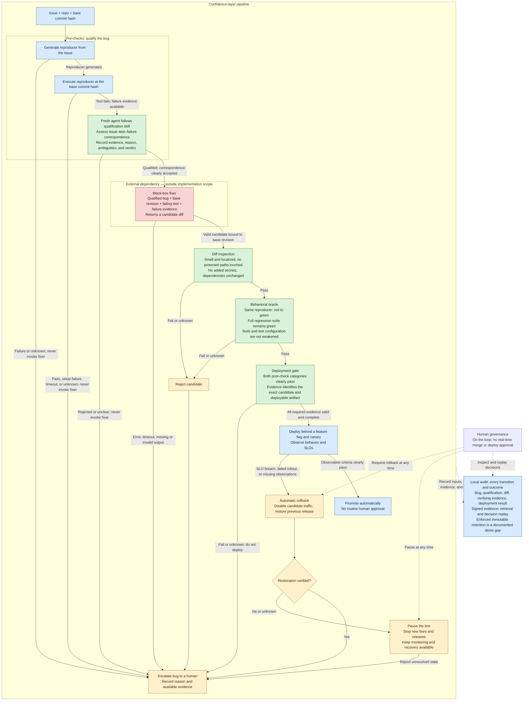

# Confidence layer: flow for review

Status: agreed planning checkpoint from the grilling discussion, 2026-10-18. This captures the agreed pipeline and constraints; unresolved implementation choices are listed explicitly below. This checkpoint does not authorize implementation.

Source: [SAP challenge brief](<SAP - AI Hackathon with Nebius & NVIDIA.pdf>), especially pages 1–2, and the team's diagram discussed in this chat.

## Agreed scope and constraints

- **Delivery constraint:** approximately one hour remains for the whole project at this checkpoint. Prefer the smallest practical implementation of the brief.
- **Target repository:** the existing `kAWEOME/nebius-nvidia-code` repository can be repurposed as needed. Express and its existing issue are available fixtures, not product requirements. The product requires at least one GitHub issue associated with the target repository to process.
- **Trivial bugs:** use the brief's definition: an automatically generated test reproduces the bug, and the resulting fix is a small, localized diff. Everything else escalates. No additional semantic bug-class allowlist is agreed. The agreed production-patch limit is one file, one diff hunk, and at most 10 added-plus-deleted lines; replacing one line counts as two. The separately generated test-only reproducer is outside this budget. Renames, binary changes, dependency changes, protected-path changes, and test weakening are disallowed.
- **Interface:** CLI and GitHub only; no dashboard. Represent issue progress through GitHub issue labels. Exact labels and triggers remain open.
- **Repository prerequisites:** accept an issue URL, an optional install command, and the existing regression-test command through the CLI. Reuse the existing test framework; require the base suite to pass, then require the preserved reproducer and full suite to pass after repair. Record supplied commands and prevent the fixer from changing them. Do not add a target-repository configuration system or automatic command discovery. Deployment setup remains a separate decision.
- **Qualification:** use one fresh agent, one short qualification skill, and one structured verdict. Require a match to the reported action, supported expected behavior, and a failure demonstrating the reported problem rather than broken setup. Permit straightforward inferences from repository documentation, tests, and surrounding code; escalate when materially different interpretations remain plausible. Record evidence and a short reason, without numeric confidence, agent voting, or a calibration framework. Fresh context does not establish absence of bias.
- **Fixer attempts:** one external fixer attempt per run. Errors, timeouts, invalid candidates, or failed gates escalate. An intentional rerun is a new recorded attempt, not an automatic repair loop.
- **Local execution and audit:** execute the pipeline locally and persist the entire trace in one directory per run. Use `gh` for GitHub access and issue-label updates; local storage itself does not depend on `gh`. Preserve inputs, execution results, skill version, judge assessments, candidate patch, and deployment observations. Local signed evidence provides tamper detection; enforced immutable retention remains an unmet brief requirement in this demo.

## How to read this flow

- **Fail closed:** a failed, missing, inconclusive, or timed-out check never counts as a pass. Before deployment, reject or escalate without shipping. After possible traffic exposure, recover the previous release and verify the result.
- **Qualification is provisional:** pre-checks establish an eligible bug and a genuine reproducible failure. The actual patch's size and locality can only be enforced after the fixer returns it. An unrelated test failure or broken environment does not qualify a bug.
- **Both post-check categories are mandatory:** diff inspection and behavioral verification cannot compensate for each other. Their sequential arrangement here is illustrative, not a scheduling requirement.
- **Evidence stays bound to its subject:** distinguish the base commit, candidate diff/revision, reproducer, test execution, and deployed artifact. The deployed artifact must be the one verification authorized. The fixer cannot weaken the tests, test command, or gate policy to manufacture success.
- **The fixer stays external:** neither its internals nor its runtime hosting/containment belongs to this implementation. Executing verification tests is part of the confidence layer.
- **Audit covers failures too:** the audit connection represents every transition, including refusal, rejection, escalation, promotion, rollback, and human intervention. Signatures establish authenticity and integrity; they do not prevent local evidence from being deleted or overwritten. Enforced immutable retention is explicitly outside the agreed local demo implementation and remains a brief requirement gap.
- **Audit failure cannot authorize release:** missing required audit evidence prevents deployment or promotion. If evidence cannot be recorded during exposure, roll back; recovery must remain possible even when the audit writer is unavailable. Report any recording gap explicitly.
- **Human intervention is an override:** pause stops new fixer and release actions; it does not stop monitoring or recovery. A human-requested rollback still requires verification. Routine successful runs need no human approval.
- **Escalation is an outcome, not an automatic approval request:** the unattended run stops. Human investigation or a later attempt is outside the successful path shown here.

## Reproducer qualification

The agreed qualification input is **Issue + repo + base commit hash**. The confidence layer generates a reproducer from the issue and executes it against that exact repository revision before invoking the fixer.

A fresh agent following a short qualification skill evaluates the issue, generated test, and execution evidence together in one assessment. It assesses whether the test exercises the reported action, what evidence supports its expected behavior, and whether the observed failure reproduces the reported symptom rather than broken setup. Record a structured verdict, supporting evidence, a short reason, and any ambiguity. All three criteria must clearly pass. A passing test, setup failure, or unclear correspondence does not qualify the bug; missing evidence and timeouts also lead to escalation without invoking the fixer.

This agent-based assessment is an agreed design choice, not a mechanism prescribed by the challenge brief. No separately approved behavioral specification is required. Straightforward inference from repository documentation, existing tests, and surrounding code is allowed, with its evidence identified and distinguished from explicit issue statements. If materially different interpretations remain plausible, escalate. Omit numeric confidence, voting agents, and a calibration framework. Qualification remains subject to bug eligibility and does not replace the later diff, regression, or deployment checks.

Required qualification audit evidence:

- Issue snapshot, repository identity, and base commit hash.
- Generated test, execution command, and execution result, including available failure evidence.
- Judge assessment and skill version: action match, expected-behavior support, failure match, supporting evidence, short reason, ambiguities, and qualification verdict.

The qualified bug, failing test, and failure evidence passed to the fixer remain bound to the same base commit hash. Qualification requires all criteria to clearly pass; no numerical confidence threshold is used.

## External fixer handoff

Send the issue, exact base revision, qualified reproducer, and failure evidence to the external fixer. Accept one candidate patch bound to that revision and verify it in a clean checkout. The fixer cannot modify the preserved reproducer or other verification controls to make its candidate pass.

The qualified reproducer is a **test-only Git patch plus metadata** containing the base SHA, test command, patch hash, and observed failure. The fixer returns a separate production-code patch against the same base SHA. Verification starts from a clean base checkout, applies both patches, and executes the preserved reproducer and full regression suite. Reject any fixer patch that changes the reproducer, other tests, or verification controls. The external provider and timeout remain open.

## Local execution and evidence

The person launching a run supplies the GitHub issue URL, optional installation command, and existing regression-test command. Installation may be omitted when dependencies are already available in the run environment. The generated reproducer supplies its own test command, which becomes fixed when qualified. Store all commands with the execution evidence. CLI flag spelling remains an implementation detail; no target-repository configuration file or automatic command discovery is required.

Store each run outside the repair target in its own local directory, containing JSON events, the issue snapshot, reproducer and candidate patches, command outputs, judge assessment and skill version, and deployment observations. A signed manifest records the evidence-file hashes. Keep the signing key outside the target and fixer workspace. Persist failure and partial-run evidence too.

Decision replay verifies signatures and hashes, then reapplies the decision rules to recorded evidence. A new model assessment or test execution is a new recorded assessment or execution, not a promise of identical output. Record the rules used so replay can identify them. Signed local files provide tamper detection, not enforced immutable retention; this limitation must remain visible in the demo. Exact serialization and signing implementation remain open.

## Required demonstration coverage

The brief calls for a handful of seeded trivial bugs completing the full path unattended through deployment and audit, followed by a genuinely difficult bug being refused and escalated. One available GitHub issue is the product's input prerequisite; it does not replace this multi-bug demonstration requirement. No exact bug count beyond the brief is agreed.

Exercises for a rejected candidate, missing evidence, canary rollback, and audit verification are additional review recommendations, not added demo acceptance requirements.

## Decisions still open

- Concrete demo application and seeded bugs; repository identity and existing Express behavior do not constrain this choice.
- Protected-path list, secret inspection, and dependency-change detection; production-patch size/locality limits are agreed.
- External fixer provider and timeout; the single-attempt handoff and test-patch transport are agreed.
- GitHub triggers, issue labels, and human pause/rollback controls; minimal CLI inputs are agreed.
- Deployment target, feature-flag mechanism, canary exposure, observation window, SLO thresholds, and rollback verification.
- Exact evidence serialization, signing implementation, and local key provisioning; local storage and recorded-evidence replay are agreed, with enforced immutable retention a documented gap.
- Which integrations can be demonstrated live, which use fixtures or simulations, and which brief requirements would remain unmet.

Patch-size limits and local execution/storage are agreed. Canary thresholds, sponsor technologies, specific bug fixtures, and deployment mechanics remain open.
